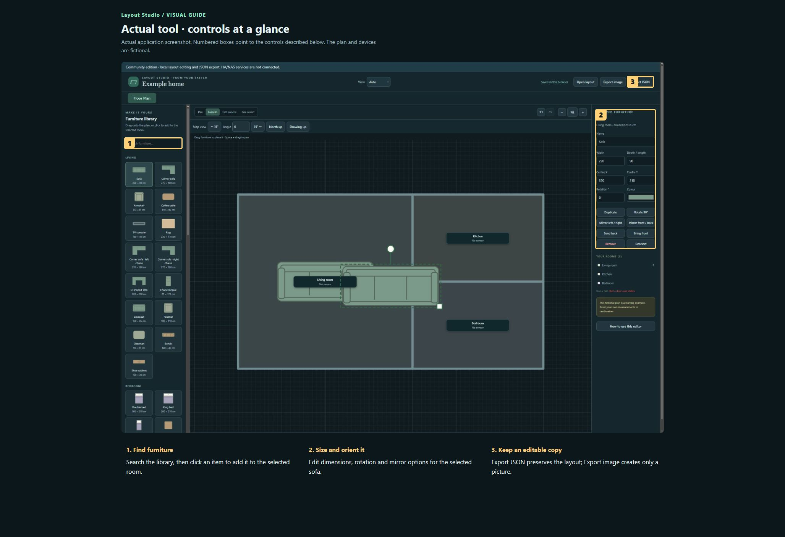
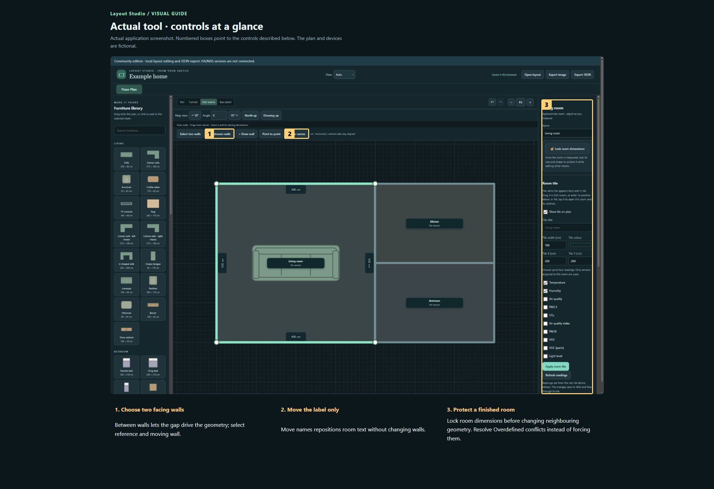
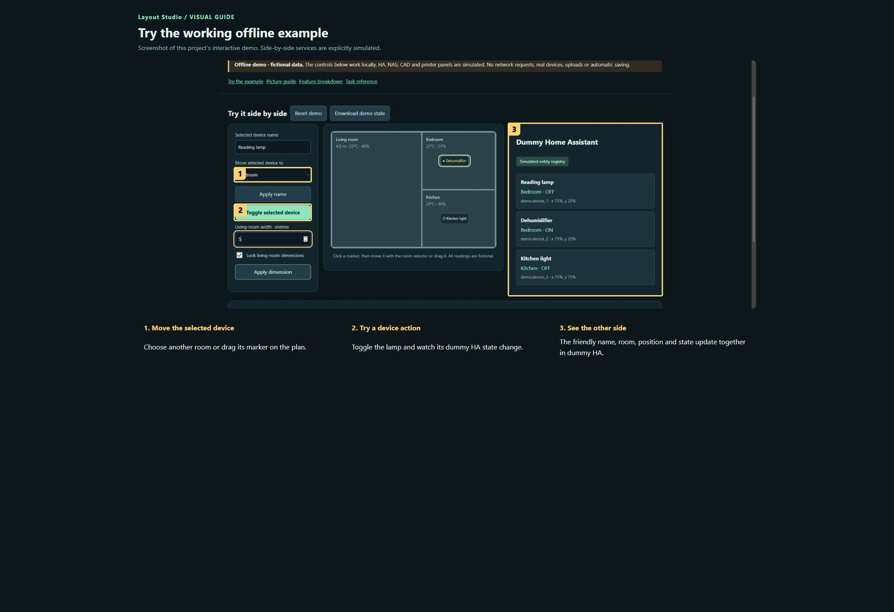

# Layout Studio

**Maintaining this project? [Start here](docs/START-HERE.md) · [Detailed handover](docs/HANDOVER.md)**

A visual floor-plan editor for drawing rooms, setting driving dimensions and arranging furniture. The NAS edition also connects that plan to Home Assistant: devices belong to rooms, room tiles show conditions, and the same layout becomes an interactive control surface. This repository includes the generic standalone editor; the connected NAS implementation remains in the private source backup. The manual distinguishes the two so a reader knows what will actually work in each edition.

[Publication checks and remaining limits](docs/PUBLICATION.md)

**Public source preview · MIT for original contributions.**

[Open the visual manual](docs/USER-MANUAL.md) · [Download the self-contained demo](demo.html) · [Release notes](CHANGELOG.md)

Download `demo.html` using GitHub’s Download raw file control, then open it in your browser. GitHub displays HTML source; it does not run the demo on this page. The demo is an offline simulation with fictional data and makes no network requests.

## See it

### Actual tool · controls at a glance

Actual application screenshot. Numbered boxes point to the controls described below. The plan and devices are fictional.

1. **Find furniture.** Search the library, then click an item to add it to the selected room.
2. **Size and orient it.** Edit dimensions, rotation and mirror options for the selected sofa.
3. **Keep an editable copy.** Export JSON preserves the layout; Export image creates only a picture.

### Actual tool · controls at a glance

Actual application screenshot. Numbered boxes point to the controls described below. The plan and devices are fictional.

1. **Choose two facing walls.** Between walls lets the gap drive the geometry; select reference and moving wall.
2. **Move the label only.** Move names repositions room text without changing walls.
3. **Protect a finished room.** Lock room dimensions before changing neighbouring geometry. Resolve Overdefined conflicts instead of forcing them.

### Try the working offline example

Screenshot of this project’s interactive demo. Side-by-side services are explicitly simulated.

1. **Move the selected device.** Choose another room or drag its marker on the plan.
2. **Try a device action.** Toggle the lamp and watch its dummy HA state change.
3. **See the other side.** The friendly name, room, position and state update together in dummy HA.

## What this tool does

| Feature | What it lets you do | Where |
| --- | --- | --- |
| Rooms and walls | Edit outlines, add internal walls, rename rooms and move name labels separately. | Both editions |
| Driving dimensions | Select facing walls and enter their separation; geometry changes to match. Existing horizontal/vertical relationships are retained. | Both |
| Collinear walls and room locks | Align wall runs, then lock a finished room’s dimensions. Conflicting constraints produce an Overdefined error. | Both |
| Furniture | Place furniture, adjust its size and rotation, and mirror asymmetric shapes. | Both |
| Map navigation | Zoom, fit and rotate the map; choose Auto, Desktop or Mobile interface mode. View rotation does not change the room dimensions. | Both |
| Devices and Device Sheet | Read HA devices, place markers, choose icons and rename records; markers may be outside room boundaries. | Connected NAS |
| Room conditions and detail views | Position editable room tiles for readings such as temperature and humidity, and open the room detail controls. | Connected NAS |
| Automations and Buttons | Separate editors for automation triggers/conditions/actions and per-press button assignments. | Connected NAS |
| HA floor plan | Control devices and move their markers back into the shared layout; mobile gestures depend on the installed HA card version. | Connected NAS |

## A first useful workflow

### Tour the workspace

1. Open the plan and locate the mode controls, map canvas and selection inspector. Choose Desktop, Mobile or Auto to suit your screen.
2. Use the fit/reset view control to see the complete plan. Zoom or rotate the view before selecting a small object. These controls change the camera, not the dimensions.
3. Select one room to inspect it. Select furniture to see its own dimensions and orientation. Clear the selection before starting a different operation.

## Saving and outputs

Standalone: browser-local draft plus explicitly exported JSON. Connected edition: a shared NAS draft, with a separate HA synchronization step. Keep JSON exports before major geometry changes. Browser storage, a screenshot and the Git source backup do not replace a backup of the saved NAS design.

## Running the actual tool

python -m http.server 8765 --bind 127.0.0.1; then open /layout-builder/

The demo has no prerequisites; the real tool may need the services described in the manual and retained source notes.

## Current boundaries

The standalone package has no working NAS login, HA discovery/sync, device sheet, automation publishing or live environmental readings. This guide documents those connected workflows for the hosted installation, not as capabilities of the standalone download. A clean HA installation and real-phone gestures have not been revalidated in this documentation update.

## Licence and sharing

MIT applies to original project contributions. Bundled/upstream software and assets retain their own terms; see [third-party notes](THIRD-PARTY.md). Keep this repository private until its own [release checklist](RELEASE-CHECKLIST.md) is complete and the owner authorises publication.
